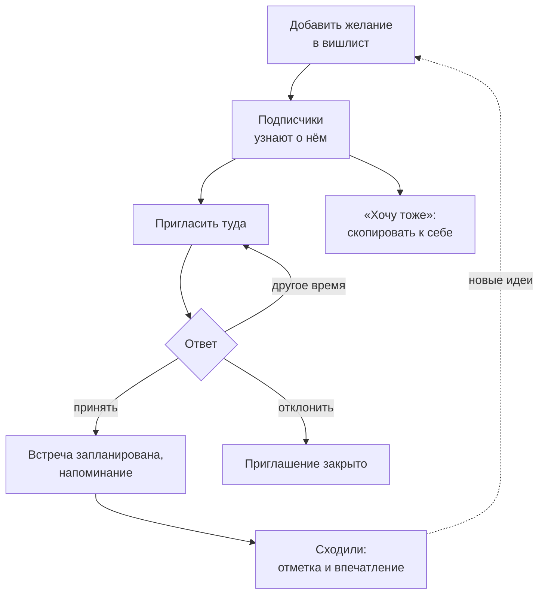

# Видение продукта НамТуда

| | |
| --- | --- |
| Статус | Утверждено |
| Версия | 1.5 |
| Дата | 10.11.2026 |

Документ описывает, каким должен стать продукт НамТуда: какую проблему он решает, для кого, что умеет и чего сознательно не делает. Структура опирается на шаблон Vision and Scope Карла Вигерса и формулу позиционирования Джеффри Мура, сокращённые под личный проект.

[Раздел 1](#1-принятые-решения) — принятые решения со ссылками на разделы, где они раскрыты.

[Разделы 2](#2-контекст-и-проблема) и [3](#3-аналоги-и-чем-мы-отличаемся) — проблема и аналоги.

[Раздел 4](#4-рассмотренные-концепции) — концепции, из которых выбирали.

Разделы с [5](#5-видение) по [13](#13-риски) раскрывают выбранную концепцию: видение, пользователей, цели, возможности, границы, ограничения, атрибуты качества, принципы развития и риски.

[Раздел 14](#14-открытые-вопросы) — вопросы, которые решаются позже.

Обозначения:

| Обозначение | Что значит | Где |
| --- | --- | --- |
| Р-n | Принятое решение | [1. Принятые решения](#1-принятые-решения) |
| Ц-n | Цель | [7. Цели и критерии успеха](#7-цели-и-критерии-успеха) |
| К-n | Атрибут качества | [11. Цели качества](#11-цели-качества) |
| ПР-n | Принцип развития | [12. Принципы развития](#12-принципы-развития) |
| РИ-n | Риск | [13. Риски](#13-риски) |
| Горизонты 1–4 | Очереди развития продукта, от ближайшей к самой далёкой | [8. Возможности продукта](#8-возможности-продукта) |
| ADR | Architecture Decision Record — запись об архитектурном решении с контекстом, вариантами и обоснованием | Папка `docs/adr/`[^adr] |

Внутренний идентификатор продукта — `namtuda`, внешний — `namtuda app` ([Р-16](#1-принятые-решения)). До ноября 2026 года проект назывался Date Wishlist Hub.

---

## 1. Принятые решения

<!-- markdownlint-disable MD033 -->
| # | Решение | Где раскрыто |
| --- | --- | --- |
| Р-1 | Концепция **Б: вишлист впечатлений с приглашениями** | [4. Рассмотренные концепции](#4-рассмотренные-концепции) [5. Видение](#5-видение) |
| Р-2 | Продукт для людей, которые уже знакомы. Подбора незнакомцев нет: он несёт юридические риски и требует сложных функций, которые сейчас не нужны | [9. Границы: чего мы не делаем](#9-границы-чего-мы-не-делаем) |
| Р-3 | Регистрация только по приглашениям. Гость без входа не видит реальные вишлисты | [6. Заинтересованные лица и пользователи](#6-заинтересованные-лица-и-пользователи) [8. Возможности продукта](#8-возможности-продукта) [9. Границы: чего мы не делаем](#9-границы-чего-мы-не-делаем) |
| Р-4 | Отдельный демо-стенд с заранее подготовленными данными и сценариями | [6. Заинтересованные лица и пользователи](#6-заинтересованные-лица-и-пользователи) [8. Возможности продукта](#8-возможности-продукта) [12. Принципы развития](#12-принципы-развития) |
| Р-5 | Первый внешний канал уведомлений — Telegram | [8. Возможности продукта](#8-возможности-продукта) [10. Ограничения](#10-ограничения) |
| Р-6 | На горизонтах 1–2 место — часть желания (личные списки), **без идентификации мест и обработки дублей** | [9. Границы: чего мы не делаем](#9-границы-чего-мы-не-делаем) [12. Принципы развития](#12-принципы-развития) |
| Р-7 | У места есть необязательная ссылка на карты и кнопка «Открыть в картах». Ссылка хранится как есть, без разбора | [8. Возможности продукта](#8-возможности-продукта) [10. Ограничения](#10-ограничения) [12. Принципы развития](#12-принципы-развития) [13. Риски](#13-риски) |
| Р-8 | Общий каталог мест, разбор ссылок, дедупликация, импорт открытых данных — горизонт 3 и позже | [8. Возможности продукта](#8-возможности-продукта) [9. Границы: чего мы не делаем](#9-границы-чего-мы-не-делаем) |
| Р-9 | География не ограничивается: ссылки на карты работают для любого города | [10. Ограничения](#10-ограничения) |
| Р-10 | Своя карта метро — после основного функционала (горизонт 3). Заранее закладываются только справочник станций и поле «станция» | [8. Возможности продукта](#8-возможности-продукта) [12. Принципы развития](#12-принципы-развития) |
| Р-11 | Название продукта — **НамТуда**. Боты Telegram: `@namtuda_app_bot` — основной стенд, `@namtuda_app_demo_bot` — демо-стенд | [10. Ограничения](#10-ограничения) |
| Р-12 | **Email не собираем.** Вход по логину и паролю. Восстановление доступа: на горизонте 1 — одноразовая ссылка сброса от администратора, на горизонте 2 — самостоятельно через привязанный Telegram | [5. Видение](#5-видение) [8. Возможности продукта](#8-возможности-продукта) [12. Принципы развития](#12-принципы-развития) |
| Р-13 | Telegram — **основной внешний канал**. Лента в приложении — **базовый канал**: в неё попадают все уведомления, даже если Telegram не привязан или недоступен; без неё не обойтись и на демо-стенде | [8. Возможности продукта](#8-возможности-продукта) [10. Ограничения](#10-ограничения) [13. Риски](#13-риски) |
| Р-14 | **Приглашать в систему может только администратор** (владелец проекта) | [6. Заинтересованные лица и пользователи](#6-заинтересованные-лица-и-пользователи) [8. Возможности продукта](#8-возможности-продукта) [13. Риски](#13-риски) |
| Р-15 | Станция метро у желания — **отдельная функция после запуска рабочего стенда** (горизонт 2). Справочник станций — Москва; модель «город → линия → станция» допускает другие города. На горизонте 1 справочник и поле только описываются в модели данных и контрактах | [8. Возможности продукта](#8-возможности-продукта) [10. Ограничения](#10-ограничения) [12. Принципы развития](#12-принципы-развития) |
| Р-16 | **Правило имён.** Внешние имена в общих пространствах имён (боты, домен, организация на GitHub, соцсети) — `namtuda app` в написании, которое допускает площадка: `namtuda_app_bot`, `namtuda-app.ru`. Внутренние имена (репозитории, конфигурация развёртывания, образы, код, базы) — `namtuda` | [10. Ограничения](#10-ограничения) [12. Принципы развития](#12-принципы-развития) [13. Риски](#13-риски) |
| Р-17 | **Хостинг: начинаем с домашнего компьютера владельца.** Переезд на VPS — когда стенд отлажен и стабильно работает | [8. Возможности продукта](#8-возможности-продукта) [10. Ограничения](#10-ограничения) [13. Риски](#13-риски) |
| Р-18 | **Запасные каналы уведомлений — горизонт 4:** Web Push (первый кандидат), бот сообщества ВКонтакте. SMS не рассматриваем | [8. Возможности продукта](#8-возможности-продукта) [9. Границы: чего мы не делаем](#9-границы-чего-мы-не-делаем) |
<!-- markdownlint-enable MD033 -->

---

## 2. Контекст и проблема

Идеи, куда сходить, есть у всех, но живут разрозненно: закладки в картах, заметки, скриншоты, сообщения в чатах. Из-за этого:

1. **Трудно позвать человека туда, куда хочется ему.** Чтобы узнать, придётся спросить напрямую, и сюрприз пропадает. Не спросить — значит угадывать.
2. **«Надо бы сходить» не превращается в поход.** Не договорились о времени, забыли, идея потерялась в переписке.
3. **Чужие интересы невидимы.** Нельзя спокойно посмотреть, куда хотел бы сходить друг, коллега или человек, с которым недавно познакомились.

Похожую задачу для подарков давно решают вишлисты: человек показывает, что хочет получить, и ему дарят именно это. НамТуда переносит эту идею на **впечатления и места**: человек показывает, куда хочет сходить, — и его зовут именно туда.

---

## 3. Аналоги и чем мы отличаемся

Похожие задачи по частям решают списки мест в картах, приложения для пар, социальные календари и афиши. НамТуда соединяет то, что в них живёт отдельно: личный список впечатлений, который человек открывает друзьям, близким и новым знакомым с нужными настройками приватности, и приглашение как главное действие. Отправная точка встречи — то, куда человеку действительно хочется сходить, а время подбирается уже под это желание.

| Аналог | Что делает хорошо | Чего нет |
| --- | --- | --- |
| Списки в Google Maps («Хочу посетить» и свои списки) | Сохранять места на карте, делиться списком, приглашать соавторов | Нет перехода «идея → приглашение → встреча» |
| Приложения для пар (Twogether, Not Pink, Tinydates, DateMatch и др.) | Общий список идей для пары, планирование, у некоторых — согласование обоими и воспоминания | Закрытое пространство для двоих, уже ставших парой; чужие вишлисты не посмотреть |
| Социальные календари и планировщики встреч с друзьями (Howbout, Open Invite, Campfire и др.) | Видно, кто когда свободен; планы, ответы «иду / не иду», приглашение по ссылке | Нет постоянного списка «куда я хочу сходить», который видят знакомые |
| Афиши (например, KudaGo) | Источник событий и мест | Не про конкретного человека и его желания |
| Заметки и чаты | Всегда под рукой | Всё теряется, нет структуры и напоминаний |

---

## 4. Рассмотренные концепции

| Концепция | Суть | Почему не выбрана |
| --- | --- | --- |
| А. «Вишлист мест» | Развитие уже реализованного (см. статусы в разделе [8. Возможности продукта](#8-возможности-продукта)): личные вишлисты, подписки, уведомления, удобство | Слабое отличие от списков в картах; мало материала для анализа процессов с несколькими участниками |
| **Б. «Вишлист впечатлений с приглашениями»** | А + приглашение как центральное действие с жизненным циклом | **Выбрана ([Р-1](#1-принятые-решения))** |
| В. «Пространство для пары» | Закрытый общий список для двоих | Плотный рынок; теряется социальная часть, часть уже написанного кода становится не нужна |

Элементы концепции В (общий список пары) остаются возможным развитием Б ([горизонт 4](#горизонт-4-возможное-развитие)).

---

## 5. Видение

### Позиционирование

Формулировка выбранной концепции ([Р-1](#1-принятые-решения)) по шаблону позиционирования Джеффри Мура:

> **Для** людей, которые хотят проводить время вместе, — друзей, пар и тех, кто только знакомится,
> **которым** трудно придумать, куда позвать человека так, чтобы ему действительно хотелось,
> **НамТуда** — **это** вишлист впечатлений,
> **который** показывает, куда хочет сходить человек, и превращает это желание в приглашение и состоявшуюся встречу.
> **В отличие от** закладок в картах, заметок и приложений для пар,
> **здесь** идея из вишлиста знакомого становится договорённостью в два шага, а не теряется в переписке.

### Коротко

**«Покажи, куда хочешь сходить, — и тебя туда позовут».**

### От желания до встречи

Основной сценарий продукта:

### Ключевые понятия

Предварительные определения; окончательные будут в глоссарии[^glossary].

| Понятие | Смысл |
| --- | --- |
| Желание | Запись в вишлисте: название, заметка, видимость, статус. Может описывать место («Кофейня на Покровке») или идею без места («Покататься на сапах»). У места необязательны ссылка на карты и, позже, станция метро ([ПР-1, ПР-2](#12-принципы-развития)) |
| Вишлист | Набор желаний пользователя |
| Подписка | Односторонний интерес к вишлисту другого пользователя с уведомлениями о новых желаниях |
| «Хочу тоже» | Копия чужого желания в свой вишлист с отметкой, откуда скопировано. Даёт сигнал «у нас общее желание» без всяких алгоритмов сопоставления |
| Приглашение | Предложение сходить куда-то вместе в конкретное время; у него есть жизненный цикл |
| Встреча | Принятое приглашение — запланированное или состоявшееся |
| Приглашение в систему | Одноразовая ссылка для регистрации нового пользователя; выдаёт только администратор. Не путать с приглашением на встречу |
| Логин | Уникальное имя для входа. Вместе с паролем заменяет email ([Р-12](#1-принятые-решения)) |
| Демо-стенд | Отдельный экземпляр системы с подготовленными данными и сценариями |

---

## 6. Заинтересованные лица и пользователи

### Заинтересованные лица

| Кто | Интерес |
| --- | --- |
| Владелец проекта (разработчик и аналитик) | Как можно полнее пройти путь создания реального продукта в рамках личного проекта: от идеи и требований до архитектуры, разработки и эксплуатации. Кроме того — портфолио и личное использование |
| Первые пользователи — владелец и знакомые | Реально планировать совместный досуг |
| Рекрутер или интервьюер | За несколько минут понять продукт и увидеть качество анализа, архитектуры и кода |
| Будущий участник проекта (возможен) | Быстро разобраться в системе по документации |

### Роли в системе

| Роль | Что делает |
| --- | --- |
| Гость | Видит страницу о продукте и вход в демо-стенд. Реальные вишлисты не видит ([Р-3](#1-принятые-решения)) |
| Пользователь — владелец вишлиста | Ведёт желания, управляет приватностью, получает приглашения |
| Пользователь — приглашающий | Смотрит вишлисты знакомых, подписывается, приглашает на встречи |
| Администратор | Единственный, кто выдаёт приглашения в систему ([Р-14](#1-принятые-решения)). Выдаёт ссылки сброса пароля, блокирует нарушителей, сбрасывает демо-данные. Роль исполняет владелец проекта |
| Демо-персонаж | Пользователь демо-стенда ([Р-4](#1-принятые-решения)), который отвечает на действия посетителя по сценарию, — чтобы один человек мог пройти весь цикл с двумя участниками |

Владелец вишлиста и приглашающий — один и тот же человек в разных ситуациях. Это роли, а не типы учётных записей.

---

## 7. Цели и критерии успеха

| # | Цель | Критерий успеха |
| --- | --- | --- |
| Ц-1 | Работающий стенд | Основной стенд доступен по постоянному адресу, [основной сценарий](#от-желания-до-встречи) проходит от начала до конца |
| Ц-2 | Наглядность для рекрутера | Посетитель демо-стенда без регистрации за 5 минут проходит сценарий «найти желание → пригласить → получить ответ демо-персонажа → отметить встречу» и по README находит, как и почему устроена система |
| Ц-3 | Личная польза | Владелец и хотя бы один знакомый реально пользуются стендом для приглашений (порог — в [открытых вопросах](#14-открытые-вопросы)) |
| Ц-4 | Документированность | У каждого реализованного сценария использования (use case) есть критерии приёмки; у каждого значимого решения — ADR; схемы соответствуют коду |
| Ц-5 | Готовность к росту | Возможность из [горизонта 3](#горизонт-3-открытие-мест-рост) добавляется без переделки существующих сервисов, кроме подключения (проверяется на первой такой возможности) |

---

## 8. Возможности продукта

Статусы: ✅ есть, 🟡 есть частично, 📋 запланировано.

**Целевое состояние стенда — горизонты 1 и 2.** Горизонты 3–4 — направления роста, к которым архитектура должна быть готова, но реализация не обещается. Горизонт — это не релиз: разбивка на релизы будет в плане развития[^roadmap].

### Горизонт 1. Фундамент и витрина

| Возможность | Статус |
| --- | --- |
| Регистрация только по одноразовому приглашению в систему ([Р-3](#1-принятые-решения)), которое выдаёт администратор ([Р-14](#1-принятые-решения)) | 🟡 регистрация есть, но открытая |
| Вход по логину и паролю вместо email ([Р-12](#1-принятые-решения)) | 🟡 вход есть, но по email |
| Выход, обновление сессии | 📋 |
| Сброс пароля по одноразовой ссылке от администратора ([Р-12](#1-принятые-решения)) | 📋 |
| Профиль: имя, город, настройки приватности и уведомлений | 🟡 есть только имя |
| Вишлист: добавить желание | ✅ |
| Вишлист: изменить, удалить, статус «сходили», метки (категория, бюджет, время суток) | 📋 |
| Необязательная ссылка на карты с проверкой домена и кнопкой «Открыть в картах» ([Р-7](#1-принятые-решения)) | 📋 |
| Видимость вишлиста и желаний: знакомым / подписчикам / только мне | 📋 |
| Поиск людей, просмотр вишлиста знакомого | ✅ |
| Подписка, отписка, «мои подписчики» | ✅ |
| «На кого я подписан» | 📋 |
| Лента уведомлений в приложении — базовый канал ([Р-13](#1-принятые-решения)) | 📋 |
| Уведомления в Telegram — первый внешний канал ([Р-5](#1-принятые-решения)): привязка через бота `@namtuda_app_bot` по одноразовой ссылке | 📋 |
| Уведомление подписчиков о новом желании | 🟡 есть, но только в лог |
| Веб-интерфейс: простой, адаптивный | 📋 |
| Основной стенд на домашнем компьютере, доступный из интернета ([Р-17](#1-принятые-решения)) | 📋 |
| Демо-стенд с подготовленными данными и сбросом одной командой ([Р-4](#1-принятые-решения)) | 📋 |
| Исправление проблем, найденных при анализе текущей реализации[^tech-debt] | 📋 |

### Горизонт 2. От желания к встрече

| Возможность | Статус |
| --- | --- |
| Пригласить на желание из своего вишлиста или вишлиста знакомого, предложив время | 📋 |
| Ответить: принять, отклонить, предложить другое время; отменить приглашение | 📋 |
| Напоминание перед встречей | 📋 |
| Отметка «сходили» обоими, впечатление (оценка или заметка) | 📋 |
| История встреч | 📋 |
| «Хочу тоже»: скопировать желание к себе с отметкой источника; счётчик копий | 📋 |
| Кто может меня приглашать: все знакомые / подписчики / никто; блокировка пользователя | 📋 |
| Настройки уведомлений по типам событий и каналам | 📋 |
| Самостоятельное восстановление пароля через привязанный Telegram ([Р-12](#1-принятые-решения)) | 📋 |
| Станция метро у желания (необязательно, справочник Москвы) и фильтр по станции — отдельной функцией после запуска стенда ([Р-15](#1-принятые-решения)) | 📋 |
| Демо-персонажи, отвечающие по сценарию | 📋 |

### Горизонт 3. Открытие мест (рост)

- **Своя карта метро** ([Р-10](#1-принятые-решения)): выбор станции из списка, просмотр желаний на схеме метро.
- **Общий каталог мест** ([Р-8](#1-принятые-решения)): разбор накопленных ссылок на карты, дедупликация задним числом, «хочу туда же» по совпадению мест. Подробности будут в ADR о модели места[^adr-place].
- **Импорт открытых данных о местах** (OpenStreetMap и подобные) и карта на MapLibre + OpenFreeMap.
- **Подборки и популярность.**

### Горизонт 4. Возможное развитие

- Общий вишлист пары, «случайная идея» с фильтрами.
- Экспорт встречи в календарь.
- Рекомендации мест.
- Запасные каналы уведомлений ([Р-18](#1-принятые-решения)): Web Push — уведомления браузера без номера телефона и email; на iPhone они работают только для приложения на экране «Домой», поэтому идут в паре с PWA. Бот сообщества ВКонтакте — на случай, если с Telegram станет совсем плохо. Email — только если пользователь сам укажет его как канал ([Р-12](#1-принятые-решения)).
- Переезд стенда на VPS ([Р-17](#1-принятые-решения)).
- PWA или мобильный клиент.

---

## 9. Границы: чего мы не делаем

| Исключение | Почему |
| --- | --- |
| Продакшн-эксплуатация, SLA, высокая нагрузка, несколько регионов | Это стенд, а не продакшн. Но архитектура не должна закрывать дорогу к масштабированию |
| Открытая регистрация | Только по приглашениям ([Р-3](#1-принятые-решения)): меньше юридических рисков и рисков безопасности |
| Подбор незнакомцев (анкеты, свайпы) | Продукт для знакомых ([Р-2](#1-принятые-решения)) |
| Идентификация мест и дедупликация на горизонтах 1–2 | При нескольких пользователях дубли никому не мешают ([Р-6](#1-принятые-решения)); делается в [горизонте 3](#горизонт-3-открытие-мест-рост) ([Р-8](#1-принятые-решения)) |
| Получение данных с карт (названия, адреса, рейтинги) | Условия картографических сервисов, как правило, запрещают сохранять и переиспользовать их данные. Ссылка только ведёт пользователя в карты |
| Чат между пользователями | Общение внутри приглашения — комментарий к ответу. Полноценный чат — отдельный продукт |
| Платежи, бронирования, монетизация | Нет бизнес-цели, большая юридическая и техническая нагрузка |
| Нативные мобильные приложения | Адаптивный веб; PWA — [горизонт 4](#горизонт-4-возможное-развитие) |
| ML-рекомендации | Избыточны для продукта такого масштаба |
| Промышленная модерация контента | Только блокировка пользователей и скрытие контента администратором |
| Уведомления по SMS ([Р-18](#1-принятые-решения)) | Платные и требуют номер телефона — лишние персональные данные ([ПР-12](#12-принципы-развития)) |

---

## 10. Ограничения

- **Команда:** один разработчик, он же аналитик.
- **Время:** 1–3 часа в день, 5–7 дней в неделю (примерно 5–20 часов в неделю), возможны периоды более активной работы. План развития строится из расчёта около 10 часов в неделю.
- **Технологии:** бэкенд на Go; существующие сервисы развиваются, а не переписываются. Технология UI выбирается в ADR о веб-интерфейсе[^adr-ui].
- **Инфраструктура:** стенд разворачивается на домашнем компьютере владельца ([Р-17](#1-принятые-решения)), позже — на VPS. Docker Compose; Kubernetes не нужен. Демо-стенд — отдельный экземпляр на той же машине. Что следует из домашнего хостинга:
  - для доступа из интернета нужен белый IP с пробросом порта либо туннель; способ выбирается в ADR о развёртывании стенда[^adr-hosting];
  - для HTTPS нужен домен — кандидат `namtuda-app.ru` ([Р-16](#1-принятые-решения)), покупка к развёртыванию стенда;
  - стенд сам поднимается после перезагрузки и сбоя питания, данные регулярно копируются, доступность отслеживается внешним мониторингом.
- **Секреты:** токены ботов Telegram ([Р-11](#1-принятые-решения)) хранятся только в `.env` на машине стенда и в репозитории не появляются.
- **Бюджет:** минимальный; внешние сервисы — на бесплатных тарифах, где это возможно.
- **Telegram в России работает с перебоями.** Это первый внешний канал уведомлений ([Р-5](#1-принятые-решения)), но сервер может не достучаться до API Telegram, а у пользователей и посетителей демо-стенда доступ может быть нестабилен. Поэтому все уведомления также попадают в ленту в приложении ([Р-13](#1-принятые-решения), [ПР-6](#12-принципы-развития), [РИ-7](#13-риски)). Технические допущения (их подтвердит ADR об интеграции с Telegram[^adr-telegram]):
  - бот получает сообщения через getUpdates (сервер сам забирает обновления), поэтому боту не нужны ни домен, ни входящие порты;
  - доступность `api.telegram.org` проверяется с машины стенда; если API недоступен, трафик к Telegram идёт через прокси — это настройка адаптера, а не переделка ([ПР-7](#12-принципы-развития));
  - для локальной разработки используется отдельный бот (например, `namtuda_app_dev_bot`): один токен может опрашивать только один экземпляр сервиса.
- **Персональные данные.** Закон требует хранить персональные данные граждан РФ в базах на территории России (ч. 5 ст. 18 152-ФЗ). Пока стенд работает на домашнем компьютере, данные хранятся в России; при переезде на VPS требование учитывается при выборе хостинга.
- **Ссылки на карты** ([Р-7](#1-принятые-решения)). Храним только ссылку, которую дал пользователь; со страниц карт ничего не забираем и короткие ссылки на сервере не разворачиваем. Правовые допущения будут зафиксированы в ADR о модели места[^adr-place].
- **Данные о станциях метро.** Первым идёт справочник Москвы ([Р-15](#1-принятые-решения)) из открытых данных data.mos.ru с указанием источника по условиям лицензии. Схему метро рисуем своего дизайна, не копируя официальную. Сама география продукта не ограничена ([Р-9](#1-принятые-решения)): ссылки на карты работают для любого города.

---

## 11. Цели качества

Три главных атрибута качества, в порядке приоритета. Позже каждый будет раскрыт измеримыми сценариями качества[^quality].

| # | Качество | Что это значит для нас |
| --- | --- | --- |
| К-1 | **Демонстрируемость** | Посетитель демо-стенда быстро проходит ключевой сценарий и находит в документации ответ на «почему так». Демо-данные и сценарии воспроизводятся одной командой |
| К-2 | **Эволюционируемость** | Новая возможность (канал уведомлений, тип события, потребитель событий, новая область) добавляется без переделки существующих сервисов |
| К-3 | **Надёжность асинхронных сценариев** | Приглашения, ответы и уведомления не теряются и не дублируются для пользователя при перезапуске любого сервиса или недоступности внешнего канала |

Обязательные свойства, которые не входят в тройку, но нарушаться не могут:

- приватность: видимость, кто может приглашать, контакты пользователя не раскрываются другим;
- минимум персональных данных;
- базовая безопасность: пароли, токены, защита межсервисного взаимодействия, проверка ссылок.

---

## 12. Принципы развития

Что заложить сейчас, чтобы рост продукта не требовал переделки. Здесь только то, что дорого менять потом; конкретные технические решения будут оформлены как ADR[^adr].

| # | Принцип | Почему сейчас | Что следует |
| --- | --- | --- | --- |
| ПР-1 | **Место — необязательная часть желания.** Желание может описывать место («Кофейня на Покровке») или идею без места («Покататься на сапах»). Места пока личные, без идентификации и обработки дублей ([Р-6](#1-принятые-решения)) | Если идеи без места потом выделять в отдельную сущность, придётся переделывать модель и все сценарии вокруг желаний | Атрибуты места в модели желания необязательны |
| ПР-2 | **Ссылка на карты — необязательная часть места.** Если пользователь её указал, она сохраняется как есть, без разбора ([Р-7](#1-принятые-решения)) | По ссылке работает кнопка «Открыть в картах». В будущем из накопленных ссылок можно собрать общий каталог мест ([горизонт 3](#горизонт-3-открытие-мест-рост)): каждое желание с местом станет личным местом в каталоге | Поле «ссылка» у места в модели желания; проверка домена ([РИ-3](#13-риски)) |
| ПР-3 | **Приватность с первого дня:** видимость у вишлиста и желаний, «кто может приглашать» | Добавлять приватность позже — значит перепроверять каждый эндпоинт и каждое событие | Сквозная концепция архитектуры «Приватность»[^concepts] |
| ПР-4 | **Связи между людьми расширяемы:** подписка — лишь один тип связи; рядом появятся блокировка и, возможно, пара | Если зашить подписку как единственную связь, пара и блокировка ломают модель | Модель связей в user-svc |
| ПР-5 | **Интеграция через версионированные события.** Каждое значимое изменение (желание добавлено, скопировано, приглашение отправлено, принято, встреча состоялась) публикуется как событие с контрактом; контракт расширяется только необязательными полями | Новые функции — уведомления, напоминания, совпадения, статистика — подключаются как новые потребители без правок у источника | Контракты событий в AsyncAPI[^asyncapi] |
| ПР-6 | **Уведомления — отдельная область.** Каналы — подключаемые адаптеры (лента в приложении, Telegram, позже другие). Контакты для уведомлений (например, `chat_id` в Telegram) хранит область уведомлений, а не сервис пользователей | Источники событий не знают про каналы; новый или запасной канал — новый адаптер. Заодно из текущей реализации уходит схема, где сервис пользователей скрывает контакты от одних сервисов и показывает другим | Развитие notify-svc, ADR об уведомлениях[^adr-notify] |
| ПР-7 | **Внешние источники — через адаптеры;** система работает и без них | Карты, каталоги, мессенджеры меняют условия или становятся недоступны | Адаптеры для каналов уведомлений сейчас, для источников мест — в [горизонте 3](#горизонт-3-открытие-мест-рост) |
| ПР-8 | **Время — всегда с часовым поясом** | Встречи назначаются на местное время; исправлять это на живых данных больно | Хранение в UTC + часовой пояс пользователя |
| ПР-9 | **Идентификация в одном месте;** новый сервис проверяет токен без общего секрета | Сейчас секрет общий у user-svc и шлюза; каждый новый сервис увеличивал бы круг владельцев секрета | ADR о токенах и межсервисном доверии[^adr-tokens] |
| ПР-10 | **Внешний API версионирован; UI ходит только через шлюз** | Позволяет менять внутренние сервисы, не ломая клиента | `/api/v1`, спецификация OpenAPI[^openapi] |
| ПР-11 | **Новый сервис — по бизнес-области, а не по таблице.** Сервис появляется, когда у области свой жизненный цикл и свои данные (например, приглашения) | Защищает и от монолита, и от сервиса на каждую сущность | Критерий выделения сервиса в сквозных концепциях архитектуры[^concepts] |
| ПР-12 | **Минимум персональных данных.** Вход по логину и паролю; email не собираем ([Р-12](#1-принятые-решения)); Telegram привязывается по желанию | Меньше данных — меньше рисков по 152-ФЗ и меньше того, что можно раскрыть по ошибке | Замена email на логин в user-svc; сброс пароля по одноразовой ссылке; восстановление через Telegram — через область уведомлений, без передачи `chat_id` в user-svc |
| ПР-13 | **Демо — отдельный экземпляр с воспроизводимыми данными и сценариями** ([Р-4](#1-принятые-решения)) | Смешивать демо и реальных пользователей в одной базе опасно для приватности | Конфигурация развёртывания, сценарии демо-персонажей |
| ПР-14 | **Справочники — отдельные версионируемые данные с указанием источника** (станции метро — [Р-10](#1-принятые-решения), позже категории) | Справочники обновляются по своему графику и приходят со своими лицензиями | Справочник станций: город → линия → станция, координаты, источник; первый город — Москва ([Р-15](#1-принятые-решения)) |
| ПР-15 | **Название продукта не попадает в контракты и код** ([Р-16](#1-принятые-решения)). Пути API, пакеты proto, топики Kafka, пути Go-модулей, имена баз и таблиц — нейтральные | Название может смениться ([РИ-10](#13-риски)); если оно живёт только в текстах, настройках развёртывания, адресах репозиториев, ботах и домене, переименование не трогает логику | Проверяется при ревью контрактов |

---

## 13. Риски

| # | Риск | Что делаем |
| --- | --- | --- |
| РИ-1 | **Холодный старт:** социальный продукт пуст без пользователей | Ценность есть уже для двоих; демо-стенд с персонажами |
| РИ-2 | **Навязчивость и безопасность приглашений** | «Кто может приглашать», блокировка, контакты не раскрываются, только знакомые, регистрация по приглашениям |
| РИ-3 | **Фишинг через ссылки:** ссылку на карты другие пользователи видят как кнопку ([Р-7](#1-принятые-решения)) | Только разрешённые домены карт, открытие в новой вкладке без передачи контекста |
| РИ-4 | **Зависимость от внешних API** ([горизонт 3](#горизонт-3-открытие-мест-рост)) | Адаптеры, работа без них ([ПР-7](#12-принципы-развития)) |
| РИ-5 | **Расползание объёма** | Горизонты, [явные исключения](#9-границы-чего-мы-не-делаем), постепенная детализация |
| РИ-6 | **Персональные данные посторонних** | Регистрация по приглашениям, минимум данных ([ПР-12](#12-принципы-развития)), хостинг с учётом 152-ФЗ |
| РИ-7 | **Telegram недоступен у пользователя или с сервера** | Лента в приложении — базовый канал, Telegram её дублирует ([Р-13](#1-принятые-решения)); доступ к API Telegram проверяется с машины стенда, при необходимости — через прокси |
| РИ-8 | **Ограниченное время** (около 10 часов в неделю) | Небольшие релизы с законченной ценностью; сначала фундамент и демо |
| РИ-9 | **Единственный администратор — узкое место:** без него нельзя зарегистрироваться и восстановить доступ | Для круга знакомых приемлемо; самостоятельное восстановление через Telegram на горизонте 2; при росте — пересмотреть [Р-14](#1-принятые-решения) (например, лимит приглашений у пользователей) |
| РИ-10 | **Совпадение названия с действующим брендом** в сфере активного отдыха (namtuda.ru) | **Принят.** Для демо-стенда и личного пользования неактуален; проверка по базе товарных знаков не проводится. Пересматривается, только если продукт решат сделать публичным. Переименование дёшево благодаря [ПР-15](#12-принципы-развития) и правилу имён ([Р-16](#1-принятые-решения)) |
| РИ-11 | **Доступность домашнего стенда:** отключение света или интернета, перезагрузка после обновлений — стенд недоступен в момент, когда его открыл рекрутер (бьёт по [К-1](#11-цели-качества)) | Автоперезапуск контейнеров и Docker, внешний мониторинг доступности, резервные копии; переезд на VPS, когда стенд стабилен ([Р-17](#1-принятые-решения)) |

---

## 14. Открытые вопросы

Эти вопросы не влияют на видение и решаются позже, когда для них появится материал.

| Вопрос | Где будет решён |
| --- | --- |
| Порог для [Ц-3](#7-цели-и-критерии-успеха) «личная польза»: сколько людей и встреч считать успехом | В требованиях[^requirements] |
| Правила видимости по умолчанию для вишлиста и желаний | В требованиях[^requirements] |
| Как домашний стенд публикуется в интернет (белый IP или туннель), резервное копирование и мониторинг; критерии переезда на VPS с учётом 152-ФЗ и доступа к API Telegram | ADR о развёртывании стенда[^adr-hosting] |
| Технология веб-интерфейса | ADR о веб-интерфейсе[^adr-ui] |
| Модель токенов и межсервисного доверия ([ПР-9](#12-принципы-развития)) | ADR о токенах и межсервисном доверии[^adr-tokens] |
| Покупка домена (кандидат `namtuda-app.ru`) | К развёртыванию стенда |

---

## История изменений

| Версия | Дата | Что изменилось |
| --- | --- | --- |
| 0.1 | 08.11.2026 | Первый черновик: проблема, аналоги, три варианта концепции, видение для варианта Б |
| 0.2 | 08.11.2026 | Выбрана концепция Б; приняты решения Р-1…Р-10: только знакомые, регистрация по приглашениям, демо-стенд, Telegram, личные списки без идентификации мест, ссылки на карты, карта метро в горизонте 3. Добавлены «Хочу тоже», лента уведомлений, демо-персонажи, ограничения по времени, хостингу, Telegram и 152-ФЗ, принципы ПР-12…ПР-14 |
| 1.0 | 09.11.2026 | Решения Р-11…Р-15: название НамТуда и боты Telegram, отказ от email (вход по логину, сброс пароля через администратора, позже через Telegram), Telegram — основной внешний канал при ленте как базовом, приглашения в систему только от администратора, справочник станций Москвы отдельной функцией после запуска стенда. В аналоги добавлены социальные календари, в риски — РИ-9 |
| 1.1 | 09.11.2026 | Решения Р-16…Р-18: правило имён (внешние — `namtuda app`, внутренние — `namtuda`), хостинг на домашнем компьютере с последующим переездом на VPS, запасные каналы уведомлений (Web Push, бот ВКонтакте) в горизонте 4. Добавлены принцип ПР-15, риски РИ-10 (совпадение названия, принят) и РИ-11 (доступность домашнего стенда), технические допущения по Telegram; SMS-уведомления исключены |
| 1.2 | 09.11.2026 | Редакционная правка перед публикацией: аннотация с навигацией и расшифровкой обозначений, ссылки между разделами, сноски о документах, которые появятся позже. Уточнены принципы ПР-1 и ПР-2 (место и ссылка на карты), позиционирование и схема основного сценария, формулировка отличий от аналогов |
| 1.3 | 10.11.2026 | Аннотация разбита на короткие абзацы, обозначения сведены в таблицу. Обозначения решений изменены с В-n на Р-n (в том числе в записях истории выше). В таблице решений — ссылки на разделы, где решение раскрыто. Общая сноска «появится позже» заменена конкретными: где появится документ, что есть сейчас и когда он появится |
| 1.4 | 10.11.2026 | Ссылки на разделы подписаны номером и названием раздела («4. Рассмотренные концепции») вместо «Раздел 4»: в таблице решений, таблице обозначений и тексте |
| 1.5 | 10.11.2026 | Название продукта пишется слитно и без кавычек: НамТуда вместо «Нам туда» (в том числе в записях истории выше) |

[^glossary]: Глоссарий — `docs/glossary.md`. Пока не создан: появится при проработке требований.
[^roadmap]: План развития — `docs/roadmap.md`, разбивка горизонтов на релизы. Пока не создан: появится после проектирования архитектуры и контрактов.
[^tech-debt]: Список найденных проблем и технического долга — `docs/architecture/risks.md`; исправление каждой значимой проблемы будет оформлено отдельным ADR. Пока не опубликован: появится при проектировании архитектуры.
[^adr]: Архитектурные решения — папка `docs/adr/`. Пока пуста: решения появятся при проектировании архитектуры.
[^adr-place]: ADR о модели места — в `docs/adr/`: модель желания и места, правила хранения ссылок на карты, правовые допущения, путь к общему каталогу мест. Пока не принято: появится при проектировании архитектуры.
[^adr-ui]: ADR о веб-интерфейсе — в `docs/adr/`: технология и способ раздачи UI. Пока не принято: сейчас у системы есть только HTTP API, интерфейса нет; появится при проектировании архитектуры.
[^adr-hosting]: ADR о развёртывании стенда — в `docs/adr/`: публикация домашнего стенда в интернет, HTTPS, резервное копирование, мониторинг, условия переезда на VPS. Пока не принято: сейчас система запускается только локально через Docker Compose; появится при проектировании архитектуры.
[^adr-telegram]: ADR об интеграции с Telegram — в `docs/adr/`: способ получения сообщений, привязка аккаунта, доступ к API. Пока не принято: появится при проектировании архитектуры, после проверки доступа к API Telegram с машины стенда.
[^adr-notify]: ADR об уведомлениях — в `docs/adr/`: каналы как адаптеры, хранение контактов, гарантии доставки. Пока не принято: сейчас notify-svc только пишет уведомления в лог; появится при проектировании архитектуры.
[^adr-tokens]: ADR о токенах и межсервисном доверии — в `docs/adr/`. Пока не принято: сейчас user-svc и шлюз проверяют JWT общим секретом, а сервисы принимают заголовки `x-service-name` и `x-user-id` без проверки; появится при проектировании архитектуры.
[^quality]: Сценарии качества — `docs/requirements/quality.md`. Пока не созданы: появятся при проработке требований.
[^requirements]: Требования — папка `docs/requirements/`: роли, сценарии использования, модель предметной области, сценарии качества. Пока не созданы: это следующий документ после видения.
[^concepts]: Сквозные концепции архитектуры — `docs/architecture/concepts.md`: приватность, авторизация, обработка ошибок, идемпотентность, события, критерии выделения сервисов. Пока не описаны: появятся при проектировании архитектуры.
[^asyncapi]: Спецификации событий в формате AsyncAPI. Пока не созданы: сейчас структура события о новом месте продублирована в коде place-svc и notify-svc; появятся при работе над контрактами.
[^openapi]: Спецификация OpenAPI шлюза — `gateway-svc/api/openapi.yaml`. Пока не создана: сейчас эндпоинты описаны таблицей в README gateway-svc и не версионированы (`/api/...`); появится при работе над контрактами.
